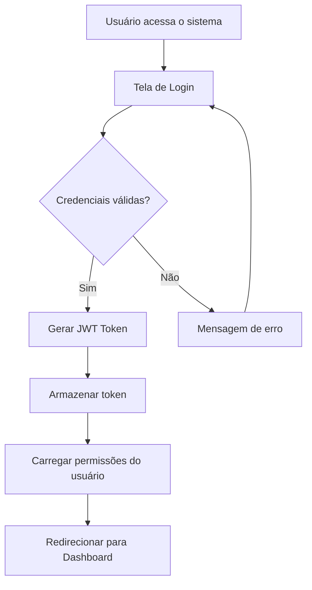
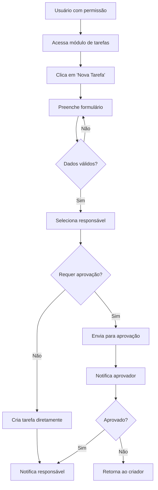
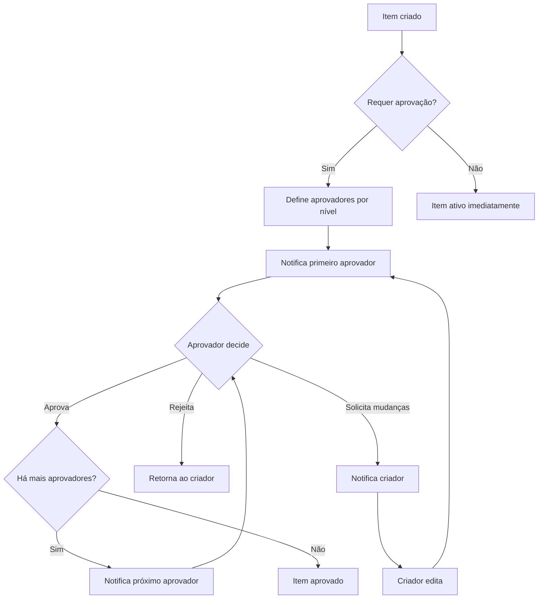
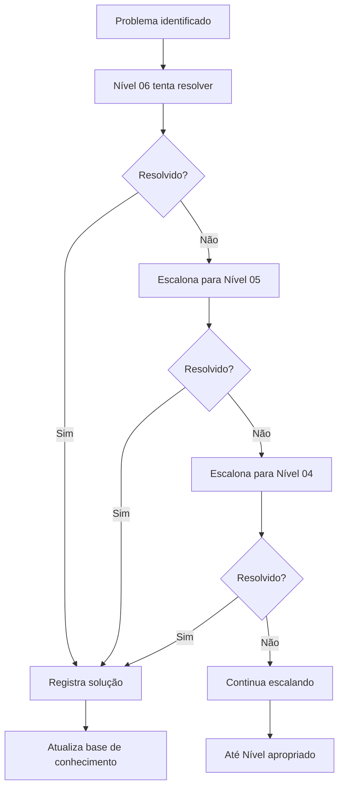
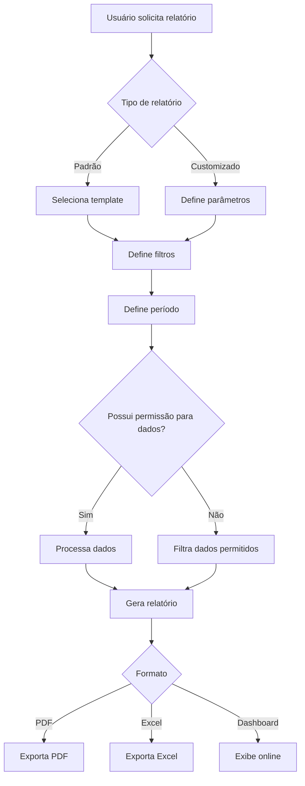
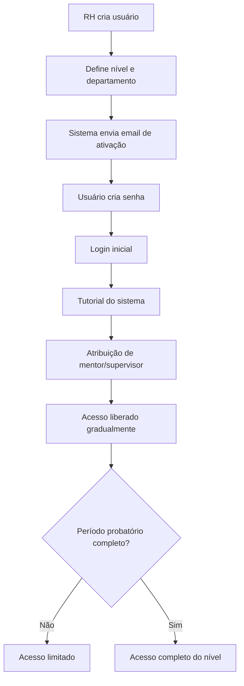
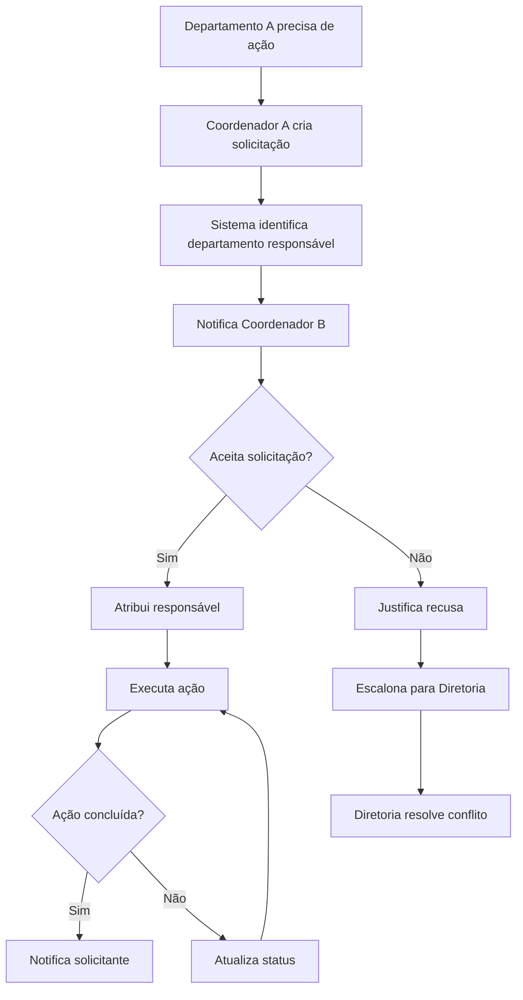
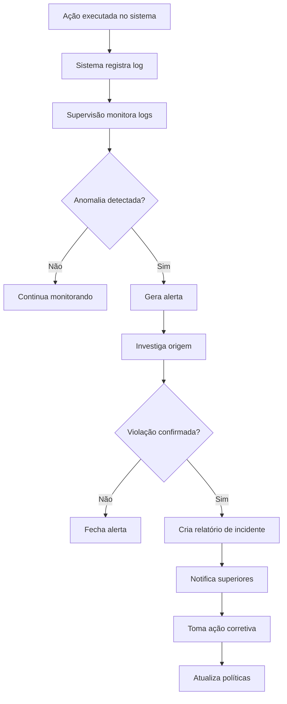
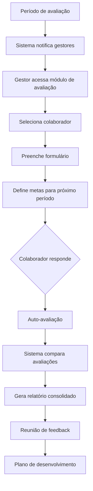
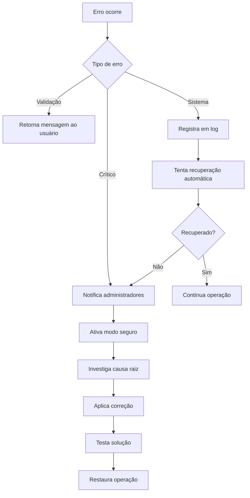

# Fluxos de Funcionamento e Visualização - Ascenda Platform

Este documento descreve os fluxos de funcionamento da plataforma, incluindo navegação, autenticação e renderização condicional de elementos.

---

## 🔄 Fluxo 1: Login do Usuário

### Descrição
Processo de autenticação do usuário e redirecionamento para o dashboard.

### Passo a Passo

```
1. Usuário acessa index.html (Página inicial)
   ↓
2. Preenche formulário de login (email + senha)
   ↓
3. Frontend envia POST para /api/auth/login
   ↓
4. Backend valida credenciais
   ↓
5. Backend retorna:
   - Token de autenticação
   - Dados do usuário (nome, categorias, permissões)
   ↓
6. Frontend armazena:
   - Token no localStorage
   - Dados do usuário no Context/Zustand
   ↓
7. Redireciona para dashboard.html
   ↓
8. Dashboard renderiza elementos conforme categorias do usuário
```

### Código de Exemplo

```javascript
// authService.js
export async function login(email, password) {
  const response = await fetch(`${API_BASE_URL}/auth/login`, {
    method: 'POST',
    headers: { 'Content-Type': 'application/json' },
    body: JSON.stringify({ email, password })
  })
  
  if (!response.ok) throw new Error('Credenciais inválidas')
  
  const data = await response.json()
  
  // Armazena token
  localStorage.setItem('token', data.token)
  
  // Armazena usuário
  localStorage.setItem('user', JSON.stringify(data.user))
  
  return data
}

// app.js (Login Form)
document.getElementById('login-form').addEventListener('submit', async (e) => {
  e.preventDefault()
  
  const email = document.getElementById('email').value
  const password = document.getElementById('password').value
  
  try {
    await login(email, password)
    window.location.href = '/pages/dashboard.html'
  } catch (error) {
    document.getElementById('error').textContent = 'Credenciais inválidas'
  }
})
```

---

## 🎨 Fluxo 2: Renderização de Ferramentas no Dashboard

### Descrição
O dashboard renderiza ferramentas diferentes baseado nas permissões de categorias do usuário logado.

### Lógica de Renderização

```javascript
// dashboard.js
import { getCurrentUser } from '../services/authService.js'
import { TOOLS, CATEGORY_NAMES } from '../utils/constants.js'

function renderDashboard(user) {
  const panelsContainer = document.getElementById('dashboard-panels')
  panelsContainer.innerHTML = ''
  
  // Obtém categorias de ferramentas que o usuário tem acesso
  const allowedCategories = user.permissions?.toolCategories || []
  
  if (allowedCategories.length === 0) {
    panelsContainer.innerHTML = '<p class="no-tools">Nenhuma ferramenta disponível.</p>'
    return
  }
  
  // Renderiza ferramentas organizadas por categoria
  allowedCategories.forEach(category => {
    const categoryTools = TOOLS[category]
    
    if (categoryTools && categoryTools.length > 0) {
      panelsContainer.innerHTML += createCategorySection(category, categoryTools)
    }
  })
}

function createCategorySection(category, tools) {
  const categoryName = CATEGORY_NAMES[category]
  
  const toolsHTML = tools.map(tool => `
    <div class="tool-card" data-tool-id="${tool.id}">
      <div class="tool-icon">${tool.icon}</div>
      <div class="tool-info">
        <h4>${tool.name}</h4>
        <p>${tool.description}</p>
      </div>
      <button class="tool-action" onclick="openTool('${tool.id}')">Abrir</button>
    </div>
  `).join('')
  
  return `
    <div class="category-section">
      <h2 class="category-title">${categoryName}</h2>
      <div class="tools-grid">
        ${toolsHTML}
      </div>
    </div>
  `
}
```

### Exemplo de Renderização por Permissões

```javascript
// Usuário com permissões:
permissions: {
  toolCategories: ['administracao', 'gerenciamento']
}

// Dashboard renderizará:
// ADMINISTRAÇÃO
// - Gestão de Equipes
// - Gestão de Squads
// - Gestão de Setores
// - Ferramentas Contábeis
// - Ferramentas Jurídicas
//
// GERENCIAMENTO
// - Gestão de Tarefas
// - Gráficos de Desempenho
// - Controle de Prazos
```
### Tabela de Ferramentas por Categoria

| Ferramenta | Categoria | Acesso |
|-----------|-----------|---------|
| Visão Estratégica | Liderança | `toolCategories: ['lideranca']` |
| Planejamento Estratégico | Liderança | `toolCategories: ['lideranca']` |
| Gestão de Departamentos | Diretoria | `toolCategories: ['diretoria']` |
| Relatórios Gerenciais | Diretoria | `toolCategories: ['diretoria']` |
| Gestão de Equipes | Administração | `toolCategories: ['administracao']` |
| Gestão de Squads | Administração | `toolCategories: ['administracao']` |
| Gestão de Setores | Administração | `toolCategories: ['administracao']` |
| Ferramentas Contábeis | Administração | `toolCategories: ['administracao']` |
| Ferramentas Jurídicas | Administração | `toolCategories: ['administracao']` |
| Coordenação de Projetos | Coordenação | `toolCategories: ['coordenacao']` |
| Alocação de Recursos | Coordenação | `toolCategories: ['coordenacao']` |
| Gestão de Tarefas | Gerenciamento | `toolCategories: ['gerenciamento']` |
| Gráficos de Desempenho | Gerenciamento | `toolCategories: ['gerenciamento']` |
| Controle de Prazos | Gerenciamento | `toolCategories: ['gerenciamento']` |
| Monitoramento de Equipe | Supervisão | `toolCategories: ['supervisao']` |
| Sistema de Aprovações | Supervisão | `toolCategories: ['supervisao']` |
| Registro de Atividades | Operacional | `toolCategories: ['operacional']` |
| Checklist de Tarefas | Operacional | `toolCategories: ['operacional']` |

---

## 🚪 Fluxo 3: Navegação entre Páginas

### Descrição
Como o usuário navega entre as diferentes partes da aplicação web.

### Estrutura de Navegação

```javascript
// Navegação simples com window.location
// Não usa React Router - é navegação tradicional HTML
        <Route path="/" element={<Index />} />
        
        {/* Dashboard - Requer autenticação */}

// Páginas:
// - /index.html (login)
// - /pages/dashboard.html (dashboard)
// - /pages/desenvolvedor.html (área do desenvolvedor)

// Login para Dashboard
document.getElementById('login-form').addEventListener('submit', async (e) => {
  e.preventDefault()
  await login(email, password)
  window.location.href = '/pages/dashboard.html'  // Navegação tradicional
})

// Dashboard para Desenvolvedor
document.getElementById('dev-link').addEventListener('click', (e) => {
  e.preventDefault()
  const user = getCurrentUser()
  
  if (user.permissions?.canAccessDev) {
    window.location.href = '/pages/desenvolvedor.html'
  } else {
    alert('Acesso negado')
  }
})

// Logout
document.getElementById('logout-btn').addEventListener('click', () => {
  logout()
  window.location.href = '/index.html'
})
```

### Proteção de Rotas

```javascript
// Cada página verifica autenticação no carregamento
// dashboard.js
document.addEventListener('DOMContentLoaded', () => {
  if (!isAuthenticated()) {
    window.location.href = '/index.html'
    return
  }
  
  const user = getCurrentUser()
  renderDashboard(user)
})

// desenvolvedor.js
document.addEventListener('DOMContentLoaded', () => {
  if (!isAuthenticated()) {
    window.location.href = '/index.html'
    return
  }
  
  const user = getCurrentUser()
  
  if (!user.permissions?.canAccessDev) {
    alert('Acesso negado')
    window.location.href = '/pages/dashboard.html'
    return
  }
  
  renderDevTools()
})
```

---

## 📋 Fluxo 4: Abertura de Ferramenta (Exemplo de Ação)

### Descrição
Fluxo completo de quando o usuário clica em uma ferramenta no dashboard.

### Passo a Passo

```
1. Usuário visualiza ferramentas no dashboard (baseado em suas permissões)
   ↓
2. Usuário clica no botão "Abrir" de uma ferramenta
   ↓
3. JavaScript captura o evento do botão
   ↓
4. Função openTool(toolId) é chamada
   ↓
5. Sistema verifica se usuário tem permissão
   ↓
6. Navegação para a página da ferramenta OU
   Renderização do componente da ferramenta
   ↓
7. Ferramenta carrega dados necessários da API
   ↓
8. Exibe interface da ferramenta
```

### Implementação

```javascript
// dashboard.js
window.openTool = function(toolId) {
  console.log('Abrindo ferramenta:', toolId)
  
  const user = getCurrentUser()
  
  // Rotas das ferramentas (a serem implementadas)
  const toolRoutes = {
    'gestao-equipes': '/pages/tools/gestao-equipes.html',
    'gestao-squads': '/pages/tools/gestao-squads.html',
    'contabilidade': '/pages/tools/contabilidade.html',
    'graficos-desempenho': '/pages/tools/graficos.html',
    // ... outras ferramentas
  }
  
  const route = toolRoutes[toolId]
  
  if (route) {
    window.location.href = route
  } else {
    alert(`Ferramenta "${toolId}" será implementada em breve!`)
  }
}
  
  const handleSubmit = async (e) => {
    e.preventDefault()
    
    try {
      // Valida dados
      if (!formData.title || !formData.assignedTo) {
        throw new Error('Preencha todos os campos obrigatórios')
      }
      
      // Envia para API
      const task = await createTask(formData)
      
      // Callback de sucesso
      onSuccess(task)
      
      // Limpa formulário
      setFormData({ title: '', description: '', assignedTo: '', dueDate: '' })
      
    } catch (error) {
      console.error('Erro ao criar tarefa:', error)
      alert(error.message)
    }
  }
  
  return (
    <form onSubmit={handleSubmit}>
      <input 
        value={formData.title}
        onChange={(e) => setFormData({...formData, title: e.target.value})}
        placeholder="Título da tarefa"
        required
      />
      {/* Outros campos... */}
      <button type="submit">Salvar</button>
    </form>
  )
}
```

---

## 🔔 Fluxo 5: Notificações em Tempo Real (Futuro)

### Descrição
Como as notificações serão exibidas para o usuário.

### Fluxo Planejado

```
1. Evento ocorre no sistema (nova tarefa atribuída)
   ↓
2. Backend envia notificação
   ↓
3. Frontend recebe via WebSocket/Polling
   ↓
4. Verifica se usuário deve receber (categorias/permissões)
   ↓
5. Exibe toast/notificação no dashboard
   ↓
6. Adiciona contador no ícone de notificações
   ↓
7. Usuário clica e visualiza detalhes
   ↓
8. Marca como lida
```

---

## 🔍 Fluxo 6: Busca e Filtros

### Descrição
Como o usuário pode buscar e filtrar informações no dashboard.

### Exemplo: Filtrar Usuários por Categoria

```typescript
// UserList.tsx
export function UserList() {
  const [users, setUsers] = useState([])
  const [selectedCategory, setSelectedCategory] = useState('all')
  
  // Busca usuários
  useEffect(() => {
    async function fetchUsers() {
      const data = await getUsers()
      setUsers(data)
    }
    fetchUsers()
  }, [])
  
  // Filtra por categoria
  const filteredUsers = useMemo(() => {
    if (selectedCategory === 'all') return users
    return users.filter(user => 
      user.categories.includes(selectedCategory)
    )
  }, [users, selectedCategory])
  
  return (
    <div>
      <select 
        value={selectedCategory}
        onChange={(e) => setSelectedCategory(e.target.value)}
      >
        <option value="all">Todas as Categorias</option>
        <option value="lideranca">Liderança</option>
        <option value="diretoria">Diretoria</option>
        {/* Outras categorias... */}
      </select>
      
      <ul>
        {filteredUsers.map(user => (
          <li key={user.id}>{user.name} - {user.categories.join(', ')}</li>
        ))}
      </ul>
    </div>
  )
}
```

---

## ⚡ Fluxo 7: Atualização de Dados em Tempo Real

### Descrição
Como manter os dados sincronizados entre diferentes usuários.

### Estratégias

1. **Polling**: Busca periódica
```typescript
useEffect(() => {
  const interval = setInterval(() => {
    fetchLatestData()
  }, 5000) // A cada 5 segundos
  
  return () => clearInterval(interval)
}, [])
```

2. **WebSocket** (Futuro):
```typescript
useEffect(() => {
  const ws = new WebSocket('ws://localhost:3000')
  
  ws.onmessage = (event) => {
    const data = JSON.parse(event.data)
    updateLocalData(data)
  }
  
  return () => ws.close()
}, [])
```

---

## 🛡️ Fluxo 8: Validação e Tratamento de Erros

### Descrição
Como erros são tratados em toda a aplicação.

### Níveis de Tratamento

```typescript
// 1. Validação no Frontend
const validateForm = (data) => {
  if (!data.email) throw new Error('Email é obrigatório')
  if (!data.email.includes('@')) throw new Error('Email inválido')
}

// 2. Tratamento em Service
export async function createUser(userData) {
  try {
    const response = await api.post('/api/users', userData)
    return response.data
  } catch (error) {
    if (error.response?.status === 400) {
      throw new Error('Dados inválidos')
    } else if (error.response?.status === 401) {
      throw new Error('Não autorizado')
    } else {
      throw new Error('Erro no servidor')
    }
  }
}

// 3. Tratamento no Componente
const handleCreate = async () => {
  try {
    validateForm(formData)
    await createUser(formData)
    showSuccess('Usuário criado com sucesso!')
  } catch (error) {
    showError(error.message)
  }
}
```

---

## 📊 Fluxo 9: Carregamento de Dados

### Descrição
Estados de carregamento e feedback visual.

### Implementação

```typescript
export function DataTable() {
  const [data, setData] = useState([])
  const [loading, setLoading] = useState(true)
  const [error, setError] = useState(null)
  
  useEffect(() => {
    async function loadData() {
      try {
        setLoading(true)
        const result = await fetchData()
        setData(result)
      } catch (err) {
        setError(err.message)
      } finally {
        setLoading(false)
      }
    }
    loadData()
  }, [])
  
  if (loading) return <Spinner />
  if (error) return <ErrorMessage message={error} />
  if (data.length === 0) return <EmptyState />
  
  return <Table data={data} />
}
```

---

## 🎯 Resumo dos Fluxos Principais

1. **Login** → Autenticação → Dashboard
2. **Dashboard** → Renderização condicional por categoria
3. **Navegação** → Rotas protegidas
4. **Ações** → Validação → API → Atualização
5. **Erros** → Tratamento em múltiplos níveis
6. **Dados** → Loading → Success/Error

Cada fluxo foi projetado para ser:
- ✅ **Claro**: Fácil de entender
- ✅ **Seguro**: Validações e permissões
- ✅ **Responsivo**: Feedback visual adequado
- ✅ **Escalável**: Fácil adicionar novos fluxos

## 🔄 Fluxos Principais

### 1. Fluxo de Autenticação



**Passos detalhados**:
1. Usuário insere email e senha
2. Frontend envia POST `/api/v1/auth/login`
3. Backend valida credenciais
4. Backend verifica nível e permissões do usuário
5. Backend gera JWT com informações do usuário
6. Frontend armazena token (localStorage/sessionStorage)
7. Frontend carrega dashboard apropriado ao nível

---

### 2. Fluxo de Criação de Tarefa



**Detalhamento por Nível**:

- **Nível 00-03**: Pode criar tarefas para qualquer nível inferior
- **Nível 04-05**: Pode criar tarefas dentro do seu escopo
- **Nível 06**: Pode criar subtarefas apenas

**Aprovações**:
- Tarefas críticas ou acima de determinado valor → Aprovação de nível superior
- Tarefas padrão → Criação direta

---

### 3. Fluxo de Aprovação



**Regras de Aprovação**:

| Item | Aprovador Mínimo | Aprovador Máximo |
|------|-----------------|------------------|
| Tarefa padrão | Nível 04 | Nível 02 |
| Tarefa crítica | Nível 02 | Nível 00 |
| Despesa < R$ 1.000 | Nível 04 | - |
| Despesa R$ 1.000-10.000 | Nível 03 | - |
| Despesa > R$ 10.000 | Nível 01 | Nível 00 |
| Contratação | Nível 02 | Nível 01 |
| Mudança estratégica | Nível 01 | Nível 00 |

---

### 4. Fluxo de Escalação de Problemas



**Critérios de Escalação**:
1. **Tempo**: Não resolvido em X horas
2. **Complexidade**: Além da competência do nível
3. **Impacto**: Afeta múltiplas áreas
4. **Urgência**: Classificação crítica

---

### 5. Fluxo de Geração de Relatórios



**Permissões por Nível**:
- **Nível 00-01**: Acesso a todos os dados
- **Nível 02-03**: Dados do setor/departamento
- **Nível 04**: Dados da unidade/equipe
- **Nível 05**: Dados para análise (agregados)
- **Nível 06**: Apenas dados próprios

---

### 6. Fluxo de Onboarding de Novo Usuário



**Checklist de Onboarding**:
- [ ] Conta criada
- [ ] Email verificado
- [ ] Senha definida
- [ ] Perfil completo
- [ ] Treinamento básico
- [ ] Mentor atribuído
- [ ] Primeiro login
- [ ] Primeiras tarefas concluídas

---

### 7. Fluxo de Comunicação Interdepartamental



---

### 8. Fluxo de Auditoria e Compliance



**Eventos Auditados**:
- Login/Logout
- Criação/Edição/Exclusão de dados
- Mudanças de permissões
- Aprovações/Rejeições
- Exportação de dados sensíveis
- Acesso a informações confidenciais

---

### 9. Fluxo de Feedback e Avaliação



---

### 10. Fluxo de Tratamento de Exceções



---

## 🔔 Sistema de Notificações

### Tipos de Notificação
1. **Imediatas**: Tarefas urgentes, aprovações críticas
2. **Agrupadas**: Resumo diário/semanal
3. **Programadas**: Lembretes de prazos

### Canais
- In-app (prioritário)
- Email
- SMS (apenas críticas)
- Push notifications (mobile)

### Configurações por Usuário
- Horário de recebimento
- Frequência
- Canais preferidos
- Tipos de evento

---

## 📊 Métricas e KPIs por Nível

### Nível 00 - Liderança
- ROI geral
- NPS
- Taxa de crescimento
- Market share

### Nível 01 - Diretoria
- Orçamento vs Real
- Performance do setor
- Taxa de turnover
- Satisfação da equipe

### Nível 04 - Gerenciamento
- Produtividade da equipe
- Cumprimento de metas
- Taxa de retrabalho
- Tempo médio de conclusão

### Nível 05 - Supervisão
- Conformidade
- Qualidade dos dados
- Indicadores de processo
- Anomalias detectadas

### Nível 06 - Operacional
- Tarefas concluídas
- Tempo de resposta
- Taxa de acerto
- Feedback recebido

---

## 🔄 Ciclos Recorrentes

### Diário
- Sincronização de dados
- Backup automático
- Geração de relatórios diários
- Limpeza de logs antigos

### Semanal
- Reuniões de equipe
- Revisão de tarefas
- Relatórios semanais
- Análise de métricas

### Mensal
- Avaliações de performance
- Revisão de metas
- Relatórios financeiros
- Planejamento do mês seguinte

### Trimestral
- Avaliações formais
- Revisão estratégica
- Análise de tendências
- Ajustes de rumo

### Anual
- Avaliação completa
- Planejamento estratégico
- Definição de OKRs
- Budget planning

---

Esta documentação de fluxos deve ser atualizada conforme novos processos são implementados ou processos existentes são otimizados.
